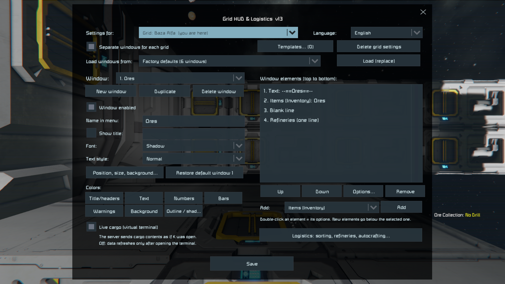
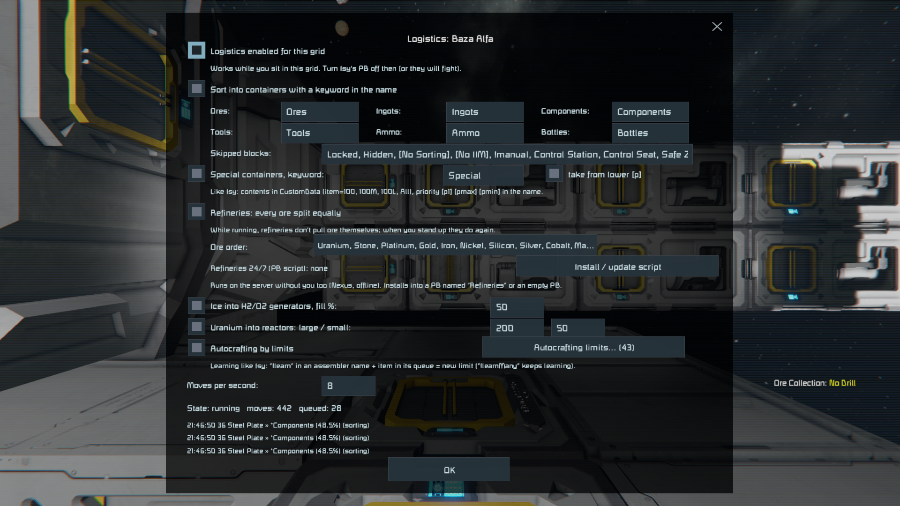
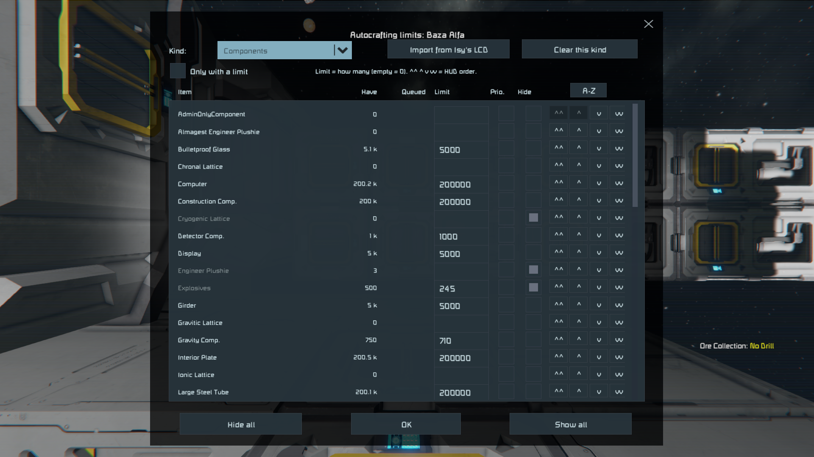
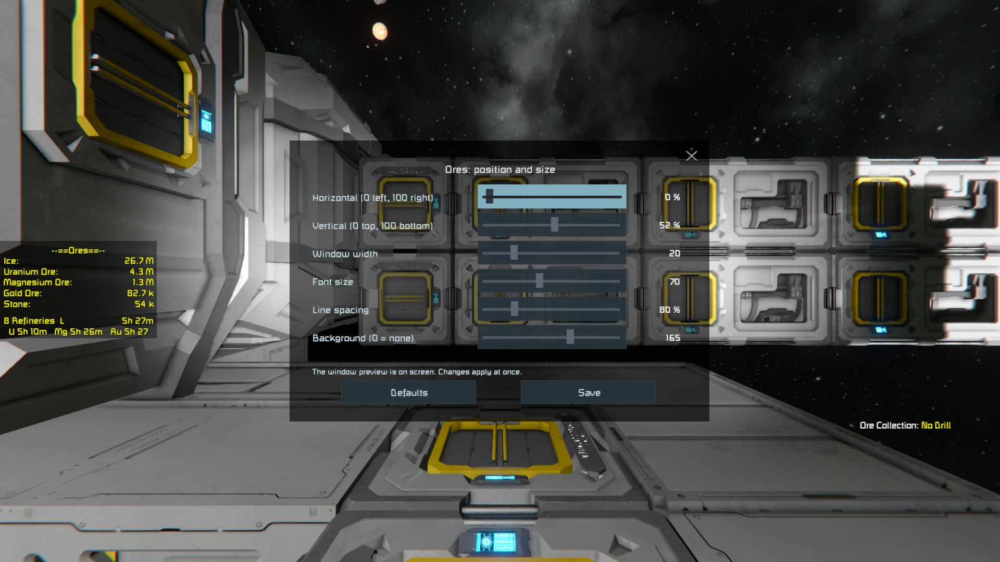
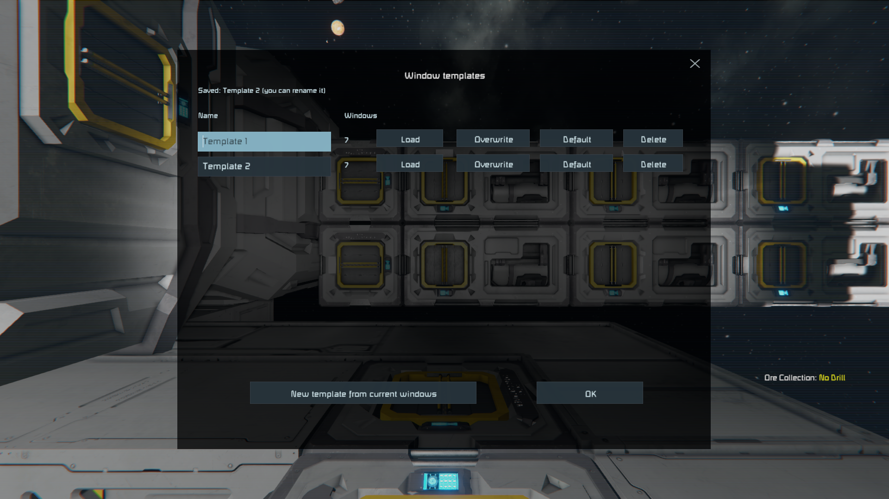

# Grid HUD & Logistics

**Your grid's data right on the HUD, plus inventory logistics: sorting, refineries and autocrafting.**
The HUD windows need no LCDs or scripts. Logistics runs inside the plugin, and an optional small PB script keeps refineries working 24/7.
A [Pulsar](https://github.com/SpaceGT/Pulsar) plugin for Space Engineers (Legacy).

**Start:** after enabling it, sit in a cockpit and type **`/data`** in chat to add windows and switch on Logistics. See [How to use](#how-to-use) · [Jak używać](#jak-używać).

[English](#english) · [Polski](#polski)

---

## English

### What it does

Grid HUD & Logistics shows windows with live data about the grid you are sitting in. They are drawn directly
on the HUD, so you don't need LCD panels, a script or a mod for them. It has two parts: **HUD windows** and **Logistics**.

### 1. HUD windows

This part replaces Automatic LCDs 2 + HudLcd.

**Windows**
- Any number of windows. You set position, size, background, colours and text style for each one.
  Text styles: normal, bold, extra bold, outline and shadow.
- **Window placement with a live view:** while you move or resize a window, the game, its HUD and your
  other windows stay visible.
- **Per-grid profiles.** Your base, your miner and your ship each get their own windows. The right set appears
  when you sit down.
- **Named templates** of window sets, which you can load into any grid.
- Polish and English.

**Elements from Automatic LCDs 2**

Most elements work like the well-known Automatic LCDs 2 commands, with the same block filters
(text in the name, `G:group`, `Type:kind`, `*`):
text and headers, inventory lists with bars and minimums, cargo fill, H2/O2 tanks, power and battery time,
power sources, jump drive and battery charge, oxygen, block contents (ammo, uranium, ice), power used,
working blocks, block counts, damage, docked grids, assembler queue, ship data (speed, altitude, gravity, mass),
clock, distance to a GPS, any terminal property, `Details` and Custom Data of any block, and the text of any LCD.
`Details` can pick lines by text, for example a shield's `CapHp:`.

**Our own elements**
- **Production calculator.** Takes what autocrafting is missing (limit minus stock) and works out:
  - how many ingots of each kind it needs. Components made from other components are broken down
    all the way to ingots, and the server's assembler efficiency is included;
  - how many of those ingots are **missing** after the ingots already in the base;
  - how much **ore** you must refine for the missing ingots;
  - how long your refineries need for it, all refineries that can refine that ore working together,
    with their speed and yield modules, plus the total time.

  A red row means there isn't enough of that ore in the base. You can count every missing item or only the ones
  you name, for example `Steel, Thruster`. The list comes from the plugin's autocrafting limits or from an
  autocrafting LCD of an inventory script.
- **Refinery calculator.** For each refinery type (modded and tiered ones too) it shows how many ingots
  you get from a chosen amount of ore and how long it takes, for one refinery and for all of that type
  together, including speed and yield modules. It can also use the ore you have in the base and add up the total time.
  You pick the refinery types and ores with checkboxes.
- **Refineries in one line:** how many refineries, how long until they finish, and the ores in the order they are refined.
- **Autocrafting on the HUD:** stock and limit of every item (from the plugin's limits or from an inventory script's LCD).
  It shows only items your assemblers can make, can show only what is missing, and can be split across windows.
- **Logistics status:** what Logistics is doing, its last moves and warnings: an assembler queue that is stuck
  (with the ingots it is waiting for), and blocks without a conveyor link (shown as `from » to`).
- **Power vs. thrusters:** power output against what ion and atmospheric thrusters draw.
- **Hydrogen balance:** H2 production against what hydrogen thrusters burn.
- **Thrust:** thrust, acceleration and lift in every direction for the current mass.

All amounts use the same units as the item lists (`13.3 k`, `1.2 M`).

### 2. Logistics

This part takes over the work of a typical inventory script. It runs inside the plugin while you sit in the grid.
- **Sorting** into containers named `Ores`, `Ingots`, `Components`, `Tools`, `Ammo` or `Bottles`.
  It also empties assembler outputs, cockpits, connectors and idle assemblers.
- **Fill level** in the names of sorted and special containers, for example `Ores (73.4%)`.
- **Special containers:** `Special` in the name. Custom Data always holds the full item list (mods too),
  where you type the wanted amounts.
- **Refineries:** your ore order comes first, picked from a list of every ore in the game, mods included.
  Every ore is split equally across all refineries. A full refinery makes room for the ore that matters.
- **Ice** goes into H2/O2 generators, and **bottles** are refilled in tanks or generators.
- **Uranium:** every reactor holds exactly the amount you set. Missing uranium is added, the excess goes back
  to `Ingots`, and if there isn't enough for all of them it is split evenly.
- **Ammo** goes into turrets and guns (WeaponCore blocks too), up to the fill level you set.
- **Docked ships** are unloaded into the base containers, and their reactors, generators and weapons
  are refuelled and rearmed. Put `[No Sorting]` or `[No IIM]` in a connector's or grid's name to skip a ship.
- **Autocrafting** by limits:
  - The missing amount is split evenly across all assemblers.
  - Queues are rebalanced, and priority items are always built first.
  - It can learn new items: put `!learn` in an assembler's name.
  - Any item can be hidden from the HUD while its limit still works.
- **Refineries and reactors 24/7 (optional):** one click installs a small programmable block script,
  about 11,000 characters. It keeps the refineries balanced and the base reactors fuelled on the server
  while you are away, even on another Nexus server. The plugin updates the script by itself.

The keywords and Custom Data formats are the same as those used by popular inventory scripts, so an existing
base works without renaming anything.

### Screenshots

| | |
|---|---|
|  |  |
|  |  |
|  |  |

### How to use

1. Enable **Grid HUD & Logistics** in Pulsar and start the game.
2. Sit in a cockpit or seat of your grid and type **`/data`** in chat.
3. Pick the grid's profile, then add windows and elements.
4. For logistics, press **Logistics** and enable it for that grid.

Chat commands: `/data` opens the settings, `/data hide` and `/data show` hide or show all windows,
and `/data pl` and `/data en` switch the language.

### How it works

- Logistics runs **while you sit in the grid**. It moves items the way a player does in the terminal. The server
  still checks ownership and conveyor connections, and blocks without a conveyor link are listed on the HUD.
- If another inventory script (PB) is running on the grid, Logistics waits and shows a warning, so the two don't fight.
- While Logistics runs, refineries and managed reactors don't pull from conveyors themselves. They do again when you stand up or leave the world. After a game crash or a lost connection they stay that way until you next sit in that grid and stand up.
- Logistics only touches blocks you can access in the terminal.
- Settings are stored in `Plugins\DaneHud.xml` in the game's data folder (by default `%AppData%\SpaceEngineers`).

### Credits

The HUD elements follow the commands players know from **Automatic LCDs 2**.
The logistics logic follows the behaviour that players know from **Isy's Inventory Manager**:
the container keywords, the special container format and the refinery and autocrafting rules.
Grid HUD & Logistics is a separate, independent implementation. It is not affiliated with either script and contains no code from them.

### License

MIT, see [LICENSE](LICENSE).

---

## Polski

### Co robi

Grid HUD & Logistics pokazuje na HUD okna z danymi grida, w którym siedzisz. Okna są rysowane prosto na HUD,
więc nie potrzebujesz do nich paneli LCD, skryptu ani moda. Plugin ma dwie części: **okna na HUD** i **Logistykę**.

### 1. Okna na HUD

Ta część zastępuje Automatic LCDs 2 + HudLcd.

**Okna**
- Dowolna liczba okien. Każdemu ustawiasz położenie, rozmiar, tło, kolory i styl tekstu.
  Style tekstu: zwykły, pogrubiony, bardzo gruby, obrys i cień.
- **Ustawianie okna z podglądem:** gdy przesuwasz albo zmieniasz rozmiar okna, widać grę, jej HUD i pozostałe okna.
- **Profile gridów.** Baza, koparka i statek mają osobne okna. Właściwy zestaw pojawia się, gdy siadasz.
- **Nazwane szablony** zestawów okien, które wczytasz do dowolnego grida.
- Język polski i angielski.

**Elementy z Automatic LCDs 2**

Większość elementów działa jak znane polecenia Automatic LCDs 2, z tymi samymi filtrami bloków
(tekst w nazwie, `G:grupa`, `Typ:rodzaj`, `*`):
tekst i nagłówki, listy przedmiotów z paskami i minimum, zapełnienie ładowni, zbiorniki H2/O2, prąd i czas baterii,
źródła prądu, naładowanie napędów skokowych i baterii, tlen, zawartość bloków (amunicja, uran, lód), pobór prądu,
stan bloków, liczba bloków, uszkodzenia, zadokowane gridy, kolejka montażowni, dane statku (prędkość, wysokość,
grawitacja, masa), zegar, odległość do punktu GPS, dowolna opcja z terminala, `Details` i Custom Data dowolnego bloku
oraz tekst dowolnego LCD. `Details` potrafi wybrać linie po tekście, np. `CapHp:` tarczy.

**Nasze własne elementy**
- **Kalkulator produkcji.** Bierze to, czego brakuje w autocraftingu (limit minus stan), i liczy:
  - ile sztabek każdego rodzaju trzeba. Części robione z innych części rozpisuje aż do sztabek,
    z uwzględnieniem mnożnika montażowni serwera;
  - ilu z tych sztabek **brakuje** po odjęciu sztabek, które już są w bazie;
  - ile **rudy** trzeba przetopić na brakujące sztabki;
  - ile czasu zajmie to Twoim rafineriom: wszystkim, które przerabiają tę rudę, razem, z ich modułami
    prędkości i uzysku, plus łączny czas.

  Czerwony wiersz oznacza, że tej rudy jest w bazie za mało. Możesz liczyć wszystkie braki albo tylko wybrane
  przedmioty, np. `Steel, Thruster`. Lista pochodzi z limitów autocraftingu w pluginie albo z LCD autocraftingu
  skryptu magazynowego.
- **Kalkulator rafinerii.** Dla każdego rodzaju rafinerii (także z modów i tierów) pokazuje, ile sztabek
  wyjdzie z wybranej ilości rudy i w jakim czasie, dla jednej rafinerii i dla wszystkich tego rodzaju razem,
  z modułami prędkości i uzysku. Może też policzyć rudę, którą masz w bazie, i podać łączny czas.
  Rodzaje rafinerii i rudy wybierasz checkboxami.
- **Rafinerie w jednej linii:** ile rafinerii, ile czasu do końca i rudy w kolejności przetapiania.
- **Autocrafting na HUD:** stan i limit każdego przedmiotu (z limitów pluginu albo z LCD skryptu magazynowego).
  Pokazuje tylko to, co potrafią zrobić Twoje montażownie, może pokazywać same braki i dzielić listę na kilka okien.
- **Stan Logistyki:** co robi Logistyka, ostatnie ruchy i ostrzeżenia: kolejka montażowni, która stoi
  (z brakującymi sztabkami), i bloki bez połączenia konwejerem (w postaci `skąd » dokąd`).
- **Prąd kontra silniki:** produkcja prądu wobec poboru silników jonowych i atmosferycznych.
- **Bilans wodoru:** produkcja H2 wobec zużycia silników wodorowych.
- **Ciąg:** ciąg, przyspieszenie i udźwig w każdą stronę przy obecnej masie.

Wszystkie ilości są w tych samych jednostkach co listy przedmiotów (`13.3 k`, `1.2 M`).

### 2. Logistyka

Ta część przejmuje pracę typowego skryptu magazynowego. Działa w pluginie, gdy siedzisz w gridzie.
- **Sortowanie** do kontenerów z nazwą `Ores`, `Ingots`, `Components`, `Tools`, `Ammo` albo `Bottles`.
  Opróżnia też wyjścia montażowni, kokpity, konektory i stojące montażownie.
- **Zapełnienie w nazwach** kontenerów sortowanych i specjalnych, np. `Ores (73.4%)`.
- **Kontenery specjalne:** `Special` w nazwie. W Custom Data jest zawsze pełna lista przedmiotów (także z modów),
  przy których wpisujesz chciane ilości.
- **Rafinerie:** najpierw rudy w Twojej kolejności, wybranej z listy wszystkich rud w grze (także z modów).
  Każda ruda jest dzielona po równo między wszystkie rafinerie. Pełna rafineria robi miejsce dla ważnej rudy.
- **Lód** trafia do generatorów H2/O2, a **butle** są napełniane w zbiornikach albo generatorach.
- **Uran:** każdy reaktor ma dokładnie ustawioną ilość. Brak jest dokładany, nadmiar wraca do `Ingots`,
  a gdy uranu nie starcza dla wszystkich, jest dzielony po równo.
- **Amunicja** trafia do wieżyczek i dział (także bloków WeaponCore) do ustawionego wypełnienia.
- **Zadokowane statki** są rozładowywane do kontenerów bazy, a ich reaktory, generatory i broń dostają paliwo,
  lód i amunicję. `[No Sorting]` albo `[No IIM]` w nazwie konektora lub grida wyklucza statek.
- **Autocrafting** według limitów:
  - brakująca ilość jest dzielona po równo na wszystkie montażownie;
  - kolejki są wyrównywane, a przedmioty z priorytetem zawsze idą pierwsze;
  - nauka nowych przedmiotów: wpisz `!learn` w nazwie montażowni;
  - każdy przedmiot można ukryć na HUD, a jego limit działa dalej.
- **Rafinerie i reaktory 24/7 (opcjonalnie):** jednym kliknięciem wgrywasz mały skrypt do bloku programowalnego
  (ok. 11 tys. znaków). Pilnuje rafinerii i paliwa w reaktorach bazy na serwerze, gdy Cię nie ma, także gdy
  jesteś na innym serwerze Nexus. Plugin sam aktualizuje skrypt.

Słowa w nazwach kontenerów i format Custom Data są takie same jak w popularnych skryptach magazynowych,
więc istniejąca baza działa bez zmiany nazw.

### Zrzuty ekranu

Są wyżej, w części angielskiej.

### Jak używać

1. Włącz **Grid HUD & Logistics** w Pulsarze i uruchom grę.
2. Usiądź w kokpicie albo fotelu swojego grida i wpisz na czacie **`/data`**.
3. Wybierz profil grida, potem dodaj okna i elementy.
4. Logistyka: przycisk **Logistyka**, a potem włącz ją dla tego grida.

Polecenia czatu: `/data` otwiera ustawienia, `/data ukryj` i `/data pokaz` chowają albo pokazują wszystkie okna,
a `/data pl` i `/data en` zmieniają język.

### Jak to działa

- Logistyka działa, **gdy siedzisz w gridzie**. Przenosi przedmioty tak, jak gracz w terminalu. Serwer dalej
  sprawdza własność i połączenie konwejerem, a bloki bez połączenia są wypisane na HUD.
- Jeśli na gridzie działa inny skrypt magazynowy (PB), Logistyka czeka i pokazuje ostrzeżenie, żeby się nie kłóciły.
- Gdy Logistyka działa, rafinerie i obsługiwane reaktory nie pobierają same z konwejera. Pobierają znowu, gdy wstaniesz albo wyjdziesz ze świata. Po crashu gry albo zerwanym połączeniu zostają tak do następnego usiądnięcia w tym gridzie i wstania.
- Logistyka rusza tylko bloki, do których masz dostęp w terminalu.
- Ustawienia są zapisane w `Plugins\DaneHud.xml` w folderze danych gry (domyślnie `%AppData%\SpaceEngineers`).

### Podziękowania

Elementy HUD działają według poleceń znanych graczom z **Automatic LCDs 2**.
Logistyka działa według reguł znanych z **Isy's Inventory Manager**: słowa w nazwach kontenerów,
format kontenerów specjalnych oraz zasady dla rafinerii i autocraftingu.
Grid HUD & Logistics to osobna, niezależna implementacja. Nie jest związany z żadnym z tych skryptów i nie zawiera ich kodu.

### Licencja

MIT, zobacz [LICENSE](LICENSE).
