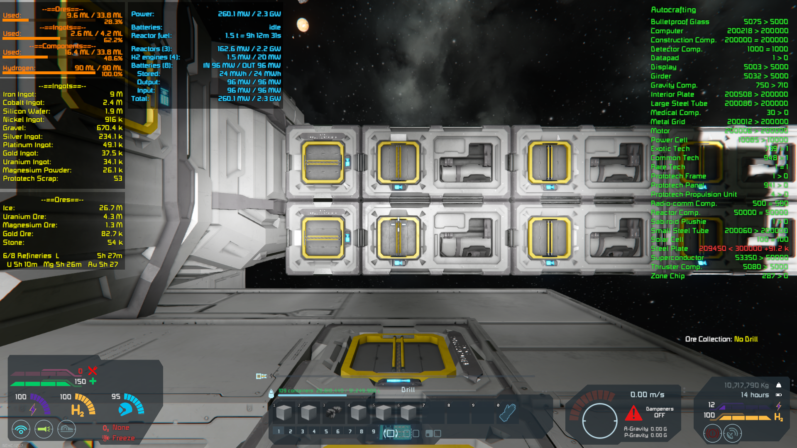
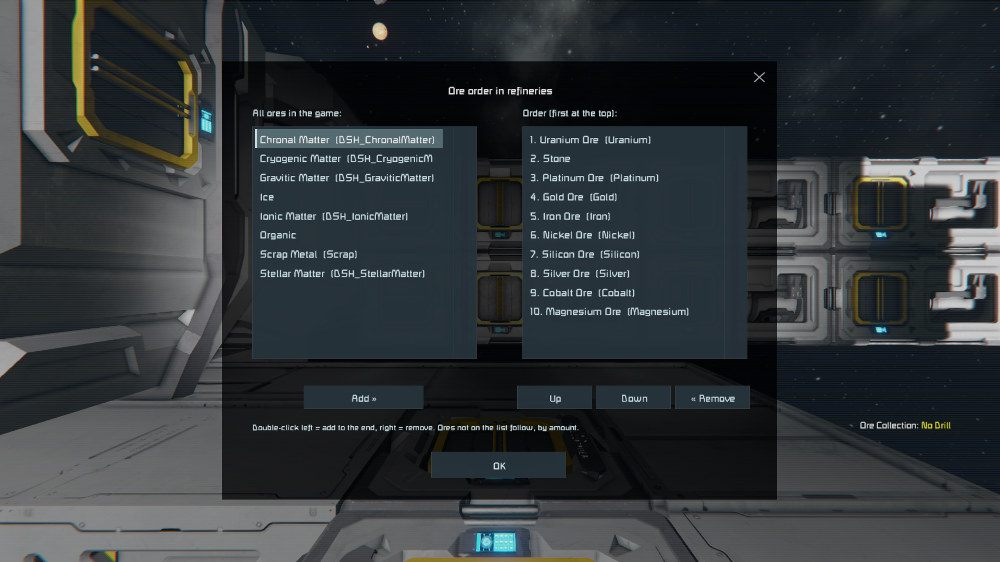

# Grid HUD & Logistics

**Your grid's data right on the HUD, plus inventory logistics: sorting, refineries and autocrafting.**
The HUD windows need no LCDs or scripts. Logistics runs inside the plugin, and an optional small PB script keeps refineries working 24/7.
A [Pulsar](https://github.com/SpaceGT/Pulsar) plugin for Space Engineers (Legacy).

[English](#english) · [Polski](#polski)

---

## English

### What it does

Grid HUD & Logistics shows windows with live data about the grid you are sitting in: power, cargo, ores, ingots,
refineries, autocrafting, block details and more. They are drawn directly on the HUD, so you don't need
LCD panels, a script or a mod for them. It has two parts.

**1. HUD windows.** This part replaces Automatic LCDs 2 + HudLcd.
- Any number of windows. You set position, size, background, colours and text style for each one.
  Text styles: normal, bold, extra bold, outline and shadow.
- Elements familiar from Automatic LCDs 2: inventory lists with bars, power and batteries, H2/O2, cargo fill,
  refineries, assembler queue, damage, working blocks, and `Details` of any block.
  `Details` can pick lines by text, for example a shield's `CapHp:`.
- **Per-grid profiles.** Your base, your miner and your ship each get their own windows. The right set appears
  when you sit down.
- **Named templates** of window sets, which you can load into any grid.
- Polish and English.

**2. Logistics.** This part takes over the work of a typical inventory script. It runs inside the plugin while you sit in the grid.
- **Sorting** into containers named `Ores`, `Ingots`, `Components`, `Tools`, `Ammo` or `Bottles`.
  It also empties assembler outputs, cockpits, connectors and idle assemblers.
- **Special containers:** `Special` in the name, and the wanted items listed in Custom Data.
- **Refineries:** your ore order comes first, picked from a list of every ore in the game, mods included.
  Every ore is split equally across all refineries. A full refinery makes room for the ore that matters.
- **Ice** goes into H2/O2 generators and **uranium** into reactors.
- **Autocrafting** by limits:
  - The missing amount is split evenly across all assemblers.
  - Queues are rebalanced, and priority items are always built first.
  - It can learn new items: put `!learn` in an assembler's name.
  - Any item can be hidden from the HUD while its limit still works.
- **Refineries 24/7 (optional):** one click installs a small programmable block script, about 6,000 characters.
  It keeps the refineries balanced on the server while you are away, even on another Nexus server.

The keywords and Custom Data formats are the same as those used by popular inventory scripts, so an existing
base works without renaming anything.

### Screenshots

| | |
|---|---|
|  |  |
|  |  |
|  |  |

### How to use

1. Enable **Grid HUD & Logistics** in Pulsar and start the game.
2. Sit in a cockpit or seat of your grid and type **`/data`** in chat.
3. Pick the grid's profile, then add windows and elements.
4. For logistics, press **Logistics** and enable it for that grid.

Chat commands: `/data` opens the settings, `/data hide` and `/data show` hide or show all windows,
and `/data pl` and `/data en` switch the language.

### How it works

- Logistics runs **while you sit in the grid**. It moves items the way a player does in the terminal. The server
  still checks ownership and conveyor connections, and blocks without a conveyor link are listed on the HUD.
- If another inventory script (PB) is running on the grid, Logistics waits and shows a warning, so the two don't fight.
- Settings are stored in `%AppData%\SpaceEngineers\Plugins\DaneHud.xml`.

### Credits

The logistics logic follows the behaviour that players know from **Isy's Inventory Manager**:
the container keywords, the special container format and the refinery and autocrafting rules.
Grid HUD & Logistics is a separate, independent implementation. It is not affiliated with Isy's script and contains no code from it.

### License

MIT, see [LICENSE](LICENSE).

---

## Polski

### Co robi

Grid HUD & Logistics pokazuje na HUD okna z danymi grida, w którym siedzisz: prąd, ładownie, rudy, sztabki,
rafinerie, autocrafting, szczegóły bloków i więcej. Okna są rysowane prosto na HUD, więc nie potrzebujesz
do nich paneli LCD, skryptu ani moda. Plugin ma dwie części.

**1. Okna na HUD.** Ta część zastępuje Automatic LCDs 2 + HudLcd.
- Dowolna liczba okien. Każdemu ustawiasz położenie, rozmiar, tło, kolory i styl tekstu.
  Style tekstu: zwykły, pogrubiony, bardzo gruby, obrys i cień.
- Elementy znane z Automatic LCDs 2: listy przedmiotów z paskami, prąd i baterie, H2/O2, zapełnienie ładowni,
  rafinerie, kolejka montażowni, uszkodzenia, działające bloki i `Details` dowolnego bloku.
  `Details` potrafi wybrać linie po tekście, np. `CapHp:` tarczy.
- **Profile gridów.** Baza, koparka i statek mają osobne okna. Właściwy zestaw pojawia się, gdy siadasz.
- **Nazwane szablony** zestawów okien, które wczytasz do dowolnego grida.
- Język polski i angielski.

**2. Logistyka.** Ta część przejmuje pracę typowego skryptu magazynowego. Działa w pluginie, gdy siedzisz w gridzie.
- **Sortowanie** do kontenerów z nazwą `Ores`, `Ingots`, `Components`, `Tools`, `Ammo` albo `Bottles`.
  Opróżnia też wyjścia montażowni, kokpity, konektory i stojące montażownie.
- **Kontenery specjalne:** `Special` w nazwie, a lista przedmiotów w Custom Data.
- **Rafinerie:** najpierw rudy w Twojej kolejności, wybranej z listy wszystkich rud w grze (także z modów).
  Każda ruda jest dzielona po równo między wszystkie rafinerie. Pełna rafineria robi miejsce dla ważnej rudy.
- **Lód** trafia do generatorów H2/O2, a **uran** do reaktorów.
- **Autocrafting** według limitów:
  - brakująca ilość jest dzielona po równo na wszystkie montażownie;
  - kolejki są wyrównywane, a przedmioty z priorytetem zawsze idą pierwsze;
  - nauka nowych przedmiotów: wpisz `!learn` w nazwie montażowni;
  - każdy przedmiot można ukryć na HUD, a jego limit działa dalej.
- **Rafinerie 24/7 (opcjonalnie):** jednym kliknięciem wgrywasz mały skrypt do bloku programowalnego
  (ok. 6 tys. znaków). Pilnuje rafinerii na serwerze, gdy Cię nie ma, także gdy jesteś na innym serwerze Nexus.

Słowa w nazwach kontenerów i format Custom Data są takie same jak w popularnych skryptach magazynowych,
więc istniejąca baza działa bez zmiany nazw.

### Zrzuty ekranu

Są wyżej, w części angielskiej.

### Jak używać

1. Włącz **Grid HUD & Logistics** w Pulsarze i uruchom grę.
2. Usiądź w kokpicie albo fotelu swojego grida i wpisz na czacie **`/data`**.
3. Wybierz profil grida, potem dodaj okna i elementy.
4. Logistyka: przycisk **Logistyka**, a potem włącz ją dla tego grida.

Polecenia czatu: `/data` otwiera ustawienia, `/data ukryj` i `/data pokaz` chowają albo pokazują wszystkie okna,
a `/data pl` i `/data en` zmieniają język.

### Jak to działa

- Logistyka działa, **gdy siedzisz w gridzie**. Przenosi przedmioty tak, jak gracz w terminalu. Serwer dalej
  sprawdza własność i połączenie konwejerem, a bloki bez połączenia są wypisane na HUD.
- Jeśli na gridzie działa inny skrypt magazynowy (PB), Logistyka czeka i pokazuje ostrzeżenie, żeby się nie kłóciły.
- Ustawienia są zapisane w `%AppData%\SpaceEngineers\Plugins\DaneHud.xml`.

### Podziękowania

Logistyka działa według reguł znanych graczom z **Isy's Inventory Manager**: słowa w nazwach kontenerów,
format kontenerów specjalnych oraz zasady dla rafinerii i autocraftingu.
Grid HUD & Logistics to osobna, niezależna implementacja. Nie jest związany ze skryptem Isy i nie zawiera jego kodu.

### Licencja

MIT, zobacz [LICENSE](LICENSE).
